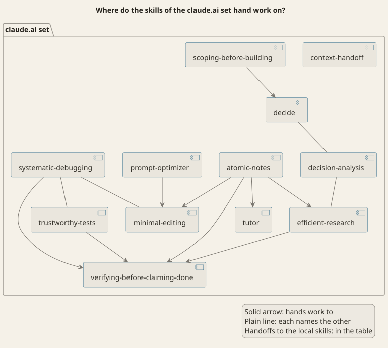

#+TITLE: dotagents architecture
#+SUBTITLE: how the parts relate and how they work together
#+OPTIONS: toc:2 num:nil ^:nil
#+STARTUP: showall

This file owns how the parts of the repository relate and how they work
together. [[file:../DESIGN.org][DESIGN.org]] owns the rules they keep;
[[file:pipeline.org][docs/pipeline.org]] owns the stages a change goes through;
[[file:glossary.org][docs/glossary.org]] owns the terms.

Each section answers one question with a diagram, then says how it works. The
diagram sources are in =docs/diagrams/=; each =.svg= is rendered from the
=.puml= next to it with the plantuml-diagrams skill.

* What lives where

What the repository holds, and what each part produces.

[[file:diagrams/arch_parts.svg]]

The diagram groups =home/.agents/= and =claude-ai/= as the shared source,
which feeds both programs: =install.py= reads it as a whole, =tools/build.py=
the members its rows name below; the adapter feeds =install.py= only. What
each edge carries:

| From                                   | To                                 | What passes                                                                                                                       |
|----------------------------------------+------------------------------------+-----------------------------------------------------------------------------------------------------------------------------------|
| =adapters/claude/settings.json=        | =install.py=                       | merged into =~/.claude/settings.json=                                                                                             |
| Shared source: =home/.agents/=         | =install.py=                       | all of it, copied to =~/.agents=                                                                                                  |
| Shared source: =claude-ai/=            | =install.py=                       | the claude.ai set, copied to =~/.agents/skills=; the overrides, read to turn off Claude Code's synced copy of each uploaded skill |
| Local skills (=home/.agents/skills/=)  | =tools/build.py=                   | the local skills named in the overrides and the project-setup templates, zipped                                                   |
| claude.ai set (=claude-ai/skills/=)    | =tools/build.py=                   | the claude.ai set, zipped                                                                                                         |
| Overrides (=claude-ai/overrides.json=) | =tools/build.py=                   | read for the local skills to zip and their short descriptions                                                                     |
| =claude-ai/README.md= (not drawn)      | =tools/build.py=                   | packed into =claude-ai-skills.zip=                                                                                                |
| =install.py=                           | =~/.agents= and each tool's folder | the installed files, written                                                                                                      |
| =tools/build.py=                       | =dist/=                            | the zips, written                                                                                                                 |
| CI (=ci.yml=)                          | =tools/validate.py=                | run on every push and pull request                                                                                                |
| CI (=ci.yml=)                          | =tests/=                           | run on every push and pull request                                                                                                |
| CI (=ci.yml=)                          | =tools/build.py=                   | run on every push and pull request                                                                                                |

- =home/.agents/= is the installed source: the global rules (=AGENTS.md=), the
  18 local skills (=skills/=), the three subagents in Claude Code format
  (=agents/=), the seven hook scripts (=hooks/=) and the path rules
  (=path-rules.json=, each skill with the file globs that call for it).
- =claude-ai/= holds the claude.ai set (=skills/=, ten skills), the overrides
  that upload local skills too (=overrides.json=, today only decide) and the
  upload guide (=README.md=).
- =adapters/claude/settings.json= is the adapter for Claude Code: no
  attribution in commits and pull requests; permission rules that allow
  =git status=, =git diff=, =git log=, =git show=, =git merge-base=,
  =git rev-parse= and =git branch --show-current=, the CMake (=--preset=,
  =--build=, =-B=), CTest, clang-format and clang-tidy commands (also their
  =-20= names) and =./build/*=; ask before =git reset --hard=, =git clean=,
  =git rebase=, =git update-ref=, =git merge=, =git branch -f= (or =--force=), =-M=, =-C= and a forced
  =git branch= delete (=-D= and each other spelling of =--delete --force=)
  (all but the first two also as =git -C <dir> ...=), the commands that land
  a branch, and =rm -rf=; deny =git push= (also as =git -C <dir> push=) and
  reading =.env= files, =~/.ssh= and =~/.gnupg=; the synced plugin
  =engineering@synced= turned off; the hook entries (seven handlers on six
  events).
- =install.py= turns the three sources into =~/.agents= and each tool's files.
- =tools/build.py= writes its zips to =dist/= (git-ignored).
- =tools/validate.py= checks the source; its docstring lists every check
  (skill and subagent frontmatter, name and description limits, a
  =LICENSE.txt= per skill, no inline backticks in skill prose, path rules
  that name a skill, no em or en dash in any tracked or trackable file, no
  unfilled template marker, no hidden text, the global rules under 200
  lines, every Python file compiling, every Org link reaching an existing
  file and its =CUSTOM_ID= or heading). The hidden-text check reads every
  tracked or trackable text file, code and tests included, and reports,
  with line, column and code point, each character a reader does not see
  but a model reads: zero width characters, bidirectional controls,
  =U+FEFF= (a byte order mark too), the soft hyphen, the invisible
  operators, the Hangul filler, the variation selectors and the tags. An
  emoji keeps its own parts (a presentation selector right after a
  pictographic character, a zero width joiner between two); a keycap and a
  tag sequence such as a subdivision flag are reported. In the Markdown
  files (=.md=, =.md.template=) agents load as instructions
  (=home/.agents/AGENTS.md=, those of a skill in either root, the subagents
  and the repository's =AGENTS.md=, =CLAUDE.md=, =GEMINI.md= and
  =.github/copilot-instructions.md=) it also reports each HTML comment
  outside code, which hides text from a reader of the rendered file but not
  from the model:
  code is a fenced block indented 0 to 3 columns from its container (the
  margin, a blockquote, a list item), closed by its own character at least
  as many times or by a line that leaves the container, or a code span on
  one line not opened by an escaped backtick. A code span over several
  lines and an indented code block are not recognised, so a =<!--= in them
  is reported.
- =tools/guard_replay.py= (not drawn) judges the shell commands of the
  maintainer's past Claude Code sessions with two versions of the guard,
  without running them, and reports what a guard change newly blocks and
  newly allows; =tools/benchmark.py= (not drawn) runs SWE-bench tasks with
  and without the method and summarizes them per arm. Both run only on the
  maintainer's machine and write to =.private/evidence/= ([[*The evidence tools][The evidence
  tools]]).
- =tests/= holds four unittest suites: the hooks fed each tool's payload
  shape, the installer run against a temporary =HOME=, the tools (validate,
  build and the commit-msg hook on a copy of the repository or on sample
  messages, the guard replay on synthetic transcripts, the benchmark against
  fake claude, podman and harness programs), and the scripts bundled with
  as-built-docs and precise-ui-changes.
- =.githooks/commit-msg= rejects a commit whose message is not the one line
  =type(scope): description= in lower case, or carries a body or an AI
  trailer, and says what to write instead. Each clone enables it once with
  =git config core.hooksPath .githooks=.
- =.github/workflows/ci.yml= runs validate, the tests and build on every push
  and pull request, on Ubuntu with Python 3.9, Ubuntu with Python 3.12 and
  Pillow, and macOS with Python 3.12.
- =docs/= holds the guides, the glossary and the diagrams; it
  produces nothing. The rules that bind live in [[file:../DESIGN.org][DESIGN.org]].

* How an install reaches each tool

What =python3 install.py= does, in order, and what each tool receives.

[[file:diagrams/arch_install.svg]]

1. Check the source. Every subagent file must parse and convert for Codex,
   Gemini CLI and Copilot CLI; the adapter must hold a hooks object and
   =overrides.json= a skills object. On any problem it prints the list,
   installs nothing and exits 1.
2. Choose the tools: the =--tools= list, or every tool whose folder
   (=~/.claude=, =~/.codex=, =~/.gemini=, =~/.gemini/antigravity-cli=,
   =~/.copilot= or =$COPILOT_HOME=, =~/.cursor=) or command (=agy= for
   Antigravity CLI) exists.
3. Shared source: copy every file of =home/.agents= to =~/.agents= (hook
   scripts made executable) and the claude.ai set into =~/.agents/skills=, so
   every tool sees both skill sets. A file left in an installed skill folder
   that the repository no longer has goes to the backup.
4. Claude Code: when =~/.claude/CLAUDE.md= lacks the import
   =@~/.agents/AGENTS.md=, replace it with one that has it (the old file goes
   to the backup); back up the =learn= and =handoff= skill copies and the hook
   copies in =~/.claude/hooks= that older versions left; link each skill
   folder in =~/.claude/skills= to =~/.agents/skills/<name>=; copy the
   subagent files unchanged to =~/.claude/agents=; write a rule
   =~/.claude/rules/dotagents-<skill>.md= per path rule, whose =paths= list
   holds the globs and whose text says to use the skill (or to read
   =~/.agents/skills/<skill>/SKILL.md= when it is not listed), and back up a
   =dotagents-*.md= rule the repository no longer has; merge the adapter into
   =~/.claude/settings.json=, adding =skillOverrides= that turn off the synced
   copy (=anthropic-skills:<name>=) of every skill also uploaded to claude.ai,
   and removing from =ask= every rule the adapter denies.
5. Codex: link =~/.codex/AGENTS.md=; write =agents/<name>.toml= (with
   =sandbox_mode= read-only for scout and =workspace-write= for the others,
   which Codex ignores in an agent file, and the reasoning effort when the
   source sets one); merge the guard, the after-edit hook and the
   session refresh (=SessionStart= after =compact= or =resume=) into
   =~/.codex/hooks.json=, which Codex asks the user to trust; write
   =rules/dotagents.rules=, whose =prefix_rule= entries forbid every push and
   publish (Codex rules are experimental).
6. Gemini CLI: link =~/.gemini/GEMINI.md=; write =agents/<name>.md= with Gemini
   tool names and a turn and time limit (=max_turns= from the source's
   =maxTurns=; =timeout_mins= 120 for gate-runner, 60 for reviewer, 30 for
   scout), above Gemini CLI's defaults of 30 turns and 10 minutes; merge the
   two hooks into =~/.gemini/settings.json= and put =AGENTS.md= first in
   =context.fileName=, so project =AGENTS.md= files load.
7. Antigravity CLI: link =~/.gemini/GEMINI.md= (the same link as Gemini
   CLI's); merge the guard and the after-edit hook into
   =~/.gemini/config/hooks.json= under the names =dotagents-guard= and
   =dotagents-after-edit=, keeping an =enabled= value set by hand; add
   =~/.agents/skills=, as an absolute path, to the entries of the skills
   manifest =~/.gemini/config/skills.json=. No subagents and no session
   refresh.
8. Copilot CLI, in =$COPILOT_HOME= when it is set, else =~/.copilot=: link
   =copilot-instructions.md=; write =agents/<name>.agent.md= with Copilot tool
   names; write =hooks/agents-global.json=.
9. Cursor: write nothing. Cursor reads =~/.agents/skills=, =~/.claude/agents=
   and the Claude Code hooks by itself, so it gets subagents and hooks only
   when Claude Code is installed too; the installer reminds the user to paste
   the global rules into Cursor's User Rules.
10. Print the number of changes, the backup folder and the notes.

How it stays safe to run again:

- An identical file is left alone, so a second run changes nothing.
- A file or link that differs is moved first to
  =~/.agents-backup/<YYYYmmdd-HHMMSS>/=, under its path relative to =HOME=.
- A settings merge adds keys and list items, lets values already set win,
  removes earlier copies of this repository's hook entries (found by script
  path) and appends the current ones. A file that does not parse, or whose
  shape cannot take the entries, is left alone with a note to merge it by hand.
- =--dry-run= prints every action and changes nothing; =--audit= lists what in
  the agents' folders does not come from the repository, and broken links.
- A whole skill, subagent, hook script or settings entry the repository
  dropped stays in the tools' folders: =--audit= shows the first three, and
  settings entries are removed by hand.

Only the Claude Code copy of a subagent keeps its =model= field; the Codex,
Gemini CLI and Copilot CLI copies carry none, so they run on the tool's
default model.

* How the skills reach claude.ai

What =python3 tools/build.py= produces, and the hand steps that take it to
claude.ai.

[[file:diagrams/arch_claude_ai.svg]]

1. Check that every override has a description; if one lacks it, stop before
   touching =dist/=.
2. Delete =dist/= and build it again.
3. One zip per skill of the claude.ai set: =dist/claude-ai/<name>.zip=.
4. One zip per local skill in =overrides.json=, with the long description in
   its =SKILL.md= replaced by the short one (claude.ai accepts at most 200
   characters).
5. =dist/claude-ai-skills.zip=: all those zips and =claude-ai/README.md=.
6. =dist/project-kit.zip=: the project-setup templates and the =LICENSE= file,
   to set up a repository by hand.

Every zip entry carries a fixed timestamp, so unchanged sources give identical
zips. The maintainer uploads each changed zip in claude.ai and pastes
=home/.agents/AGENTS.md= into its instructions. claude.ai then syncs its copies
into Claude Code as =anthropic-skills:<name>=; the =skillOverrides= that the
installer wrote keep them off, so Claude Code loads each skill once, from
=~/.claude/skills= ([[file:../DESIGN.org::#skills-load-locally][DESIGN.org, skills-load-locally]]).

* What a session loads

What an agent reads at the start of a session, and what it loads later on
demand.

[[file:diagrams/arch_session.svg]]

1. Global rules. Each tool reaches =~/.agents/AGENTS.md= through its own file:
   the import in =~/.claude/CLAUDE.md=, the links =~/.codex/AGENTS.md=,
   =~/.gemini/GEMINI.md= (Gemini CLI and Antigravity CLI) and
   =~/.copilot/copilot-instructions.md=, and a paste
   in Cursor's User Rules and in claude.ai's instructions.
2. Project rules: the repository's own =AGENTS.md=. Claude Code reads it by
   itself only when the repository has no =CLAUDE.md=, and Gemini CLI only
   when its settings name it, so project-setup always creates the bridges
   =CLAUDE.md= and =GEMINI.md=, which import =AGENTS.md=, and
   =.github/copilot-instructions.md=, which points to it (Copilot CLI and
   Cursor, which also read =CLAUDE.md=, then load the rules twice, and Gemini
   CLI may too, since the installer adds =AGENTS.md= to its
   =context.fileName=), and proposes replacing a bridge that duplicates rules
   with its template.
3. Skill descriptions. Only each skill's name and description are listed at
   the start. The body of a =SKILL.md= loads when a request matches its
   description or the user names it; files next to it (templates, scripts,
   the palette) load only when a step reads them.
4. Compaction brief and session refresh. In Claude Code, before a compaction
   the tool runs the compaction brief, which tells the summary what resuming
   the task needs. In Claude Code and Codex, after a compaction or a resume the
   tool runs the session refresh, which adds a stale-memory reminder, the real
   git state and the newest task notes to the context.
5. Path rules (Claude Code). When the agent reads or edits a file that
   matches a rule's globs (QML, PlantUML, tests), the rule loads and points
   it to qt-quick, plantuml-diagrams or trustworthy-tests. The globs are
   relative to the session's primary working directory, so a session meant
   for a sibling worktree starts in that worktree.
6. Subagents. A skill step delegates to a subagent, which starts in a fresh
   context with its own file as instructions and its own tool list, and
   returns a compact result instead of the files or logs it read. Without
   subagents, the skill follows =~/.agents/agents/<name>.md= itself.
7. Hooks. The tool, not the model, runs the guard before each shell command
   and the after-edit hook after each edit, and passes their replies on to
   the model (the hooks section below).

| Subagent    | Model in Claude Code | Returns                                 |
|-------------+----------------------+-----------------------------------------|
| scout       | sonnet               | a cited brief of the area               |
| gate-runner | haiku, low effort    | a verdict table and the first errors    |
| reviewer    | opus, high effort    | findings ranked blocker, major, minor   |

scout and reviewer only read and run read-only commands; gate-runner runs the
documented gate commands and fixes nothing, at low effort, since it reports
and decides nothing (Codex gets the same reasoning effort; Gemini CLI and
Copilot CLI have no such field). In Claude Code gate-runner also
starts without the user, project and local =CLAUDE.md= files (=omitClaudeMd=,
Claude Code v2.1.271 or later); the other tools' copies drop the field.

Each subagent has a turn limit, =maxTurns=: 250 for scout and reviewer, 200
for gate-runner. In Claude Code a subagent that reaches it returns its output
marked partial, and the caller can resume it (v2.1.246 or later); Gemini CLI
takes the same number as =max_turns=. The values sit above the longest of
about 490 past runs on this machine (scout 173 turns, reviewer 165,
gate-runner 154 apart from one run of 280), so only a runaway stops early.

* The workflow skills

Which skills and subagents serve each stage of a change; the stages
themselves, with what each leaves and where, are in [[file:pipeline.org][docs/pipeline.org]].

[[file:diagrams/arch_skills_workflow.svg]]

What each edge carries:

| From          | To                            | What passes                                           |
|---------------+-------------------------------+-------------------------------------------------------|
| project-setup | decide                        | the open points the repository does not answer        |
| spec          | decide                        | each design choice                                    |
| spec          | implement, in a fresh session | the spec file                                         |
| implement     | decide                        | the user's choices                                    |
| implement     | trustworthy-tests             | each test, written first                              |
| implement     | systematic-debugging          | a problem after two failed fixes                      |
| session-close | implement, in a fresh session | the handoff                                           |
| implement     | isolated-work                 | the worktree to create; on the user's go, the landing |

1. Set up: project-setup runs once per repository. scout surveys it, decide
   settles what the repository does not answer, and gate-runner runs each
   validation command once.
2. Decide and specify: spec maps the area with scout, settles each design
   choice with decide, and has a subagent that did not write it check the
   spec (in Claude Code the general-purpose subagent, elsewhere reviewer).
3. Implement, gates and review: a fresh session runs implement on the spec
   file. implement grounds the plan with scout (skipped when the spec records
   the commit its check ran on and none of the spec's affected paths changed
   since, as =git diff --quiet= shows) and its own reading of the files it
   will touch, takes the user's choices to decide, writes each test first by
   trustworthy-tests, turns to systematic-debugging after two failed fixes,
   runs the full gates through gate-runner and the review through reviewer,
   and creates the worktree through isolated-work when the plan's isolation
   was approved.
4. On request: gates and branch-review are the user's direct way to the same two
   subagents; implement calls the subagents itself, not these skills.
5. Close: session-close writes the handoff that the next fresh session reads
   before resuming implement.
6. Land and clean up: on the user's go, isolated-work rebases the branch,
   gates the rebased commit through gate-runner, fast-forwards the target and
   removes the worktree and the branch. It skips the gate run only when the
   rebase left the pinned commit unchanged and the progress log records the
   full gates passing on a clean tree at that hash.

decide is where every choice that belongs to the user is settled. Besides the
callers drawn here, architecture-doc, mechanical-changes, parallel-agents,
decision-analysis and scoping-before-building send their choices to it.

* The specialist skills

Where the specialist skills hand work on.

[[file:diagrams/arch_skills_specialist.svg]]

What each edge carries; a plain line names both skills, so its row reads both
ways:

| From                        | To                   | What passes                                                                                                                         |
|-----------------------------+----------------------+-------------------------------------------------------------------------------------------------------------------------------------|
| architecture-doc            | plantuml-diagrams    | its diagrams, to draw and check                                                                                                     |
| as-built-docs               | plantuml-diagrams    | its diagrams, to draw and check                                                                                                     |
| as-built-docs               | precise-ui-changes   | its screen pictures, made repeatable                                                                                                |
| as-built-docs               | code-audit           | a list of suspicious behavior                                                                                                       |
| architecture-doc            | spec                 | a build order whose every step is ready for spec                                                                                    |
| architecture-doc            | clean-architecture   | clean-architecture's layers, for an application (plain line)                                                                        |
| code-audit                  | implement            | a finding the user wants fixed                                                                                                      |
| precise-ui-changes          | trustworthy-tests    | a behavior test for a visual bug that plays out over time                                                                           |
| parallel-agents             | mechanical-changes   | shards to spread over several agents (to parallel-agents); a one-rule change across many files (to mechanical-changes) (plain line) |
| mechanical-changes          | implement            | the change, as a task with its shards as plan steps                                                                                 |
| parallel-agents (not drawn) | implement            | each agent's approved plan steps, run from section 5 (each writer's worktree goes through isolated-work)                            |
| parallel-agents             | isolated-work        | each writer's worktree, created and later landed                                                                                    |
| isolated-work               | implement            | its change, run through implement                                                                                                   |
| clean-architecture          | qt-quick             | the layers, applied in Qt (plain line)                                                                                              |
| clean-architecture          | event-driven-ui      | the threads                                                                                                                         |
| qt-quick                    | event-driven-ui      | the threads, applied in Qt (plain line)                                                                                             |
| event-driven-ui             | systematic-debugging | a freeze whose cause is not yet measured (to systematic-debugging); a blocked UI thread (to event-driven-ui) (plain line)           |
| clean-architecture          | spec                 | a feature's steps, as the plan's steps                                                                                              |
| clean-architecture          | implement            | a feature's steps, as the plan's steps                                                                                              |

- Documents and audits. architecture-doc and as-built-docs draw their diagrams
  with plantuml-diagrams. architecture-doc ends with a build order whose every
  step is ready for spec. as-built-docs makes its screen pictures repeatable
  as precise-ui-changes does, and hands a list of suspicious behavior to
  code-audit. code-audit fixes nothing: a finding the user wants fixed goes to
  implement, starting with a failing test. In precise-ui-changes, a visual bug
  that plays out over time also needs a behavior test from trustworthy-tests.
- Changes across files. mechanical-changes runs as an implement task, with its
  shards as plan steps; to spread the shards over several agents it uses
  parallel-agents, which sends a one-rule change across many files back to
  mechanical-changes. Each parallel agent runs implement from section 5 with
  its approved plan steps, in a worktree that isolated-work creates and later
  lands. isolated-work runs its change through implement.
- Application design. clean-architecture gives the layers, event-driven-ui the
  threads, and qt-quick applies both in Qt. architecture-doc uses
  clean-architecture's layers for an application, and under spec or implement
  clean-architecture's steps for a feature become the plan's steps. A freeze
  whose cause is not yet measured goes to systematic-debugging first, which
  sends a blocked UI thread back to event-driven-ui.

The subagents these skills use:

- architecture-doc maps an existing codebase with scout and has both documents
  reviewed by a subagent that did not write them (the general-purpose
  subagent in Claude Code, reviewer elsewhere).
- as-built-docs reads the code with read-only subagents on the session's model
  (the general-purpose subagent in Claude Code, the tool's default general
  agent elsewhere), not with scout, and has each document fact-checked by one
  that did not write it (the general-purpose subagent in Claude Code, reviewer
  elsewhere); gate-runner runs its long pass or fail checks.
- code-audit maps with scout and tries to refute each finding with a subagent
  given only the claim and the code (the general-purpose subagent in Claude
  Code, elsewhere reviewer told that its target is the claim, not the branch
  diff).
- mechanical-changes sends its review to reviewer. parallel-agents gates each
  branch through isolated-work, which runs gate-runner on the rebased commit
  (unless the rebase left it unchanged and its pass is logged), and reviews
  the merged result through implement's review.

* The claude.ai skills

Where the skills of the claude.ai set hand work on.

What each edge carries; a plain line names both skills, so its row reads both
ways. The rows to Local skills are handoffs to the skills of the other maps,
which the diagram leaves out so that no line crosses the whole map:

| From                    | To                             | What passes                                                                                                                          |
|-------------------------+--------------------------------+--------------------------------------------------------------------------------------------------------------------------------------|
| scoping-before-building | decide                         | the user's choices                                                                                                                   |
| decide                  | decision-analysis              | outside products to compare (plain line)                                                                                             |
| decision-analysis       | efficient-research             | the facts (plain line)                                                                                                               |
| efficient-research      | verifying-before-claiming-done | its answer, checked before it is settled                                                                                             |
| prompt-optimizer        | minimal-editing                | a single requested change                                                                                                            |
| systematic-debugging    | minimal-editing                | the fix (to minimal-editing); the fix of a failure, to diagnose first (to systematic-debugging) (plain line)                         |
| systematic-debugging    | trustworthy-tests              | a failing test that reproduces the failure (to trustworthy-tests); a flaky or unclear failure (to systematic-debugging) (plain line) |
| systematic-debugging    | verifying-before-claiming-done | the fix, checked before saying it is fixed                                                                                           |
| trustworthy-tests       | verifying-before-claiming-done | the tests, checked before saying they are done                                                                                       |
| scoping-before-building | Local skills                   | open work in a repository, to spec; a new system, to architecture-doc                                                                |
| decide                  | Local skills                   | a decision too large, to spec                                                                                                        |
| prompt-optimizer        | Local skills                   | a repository's =AGENTS.md=, to project-setup                                                                                         |
| context-handoff         | Local skills                   | a handoff inside a repository, to session-close                                                                                      |
| systematic-debugging    | Local skills                   | a fix of more than one sentence, to implement; work that blocks a UI thread, to event-driven-ui                                      |

The set is the ten skills of =claude-ai/skills/= plus decide, uploaded through
its override. The installer puts all of them in every local agent too, so the
same hand-offs work in chat and in a repository; a hand-off to a local skill
applies where that skill is installed (the texts say "where available").

- Debugging: systematic-debugging diagnoses first, reproduces the failure with
  a test by trustworthy-tests, applies the fix with minimal-editing, or with
  implement where it is available and the fix is more than a one-sentence
  change (implement then writes the failing test), and checks with
  verifying-before-claiming-done before saying it is fixed. It sends work
  that blocks a UI thread to event-driven-ui. trustworthy-tests sends a flaky
  or unclear failure back to systematic-debugging, and minimal-editing sends
  the fix of a failure there first.
- Choices: efficient-research gathers the facts, decision-analysis commits to
  a recommendation, and a choice inside the user's own project goes to decide,
  which turns to decision-analysis to compare outside products and proposes a
  spec when a decision is too large.
- Scoping: scoping-before-building sends the user's choices to decide, open
  work in a repository to spec, and a new system to architecture-doc.
- Prompts and handoffs: prompt-optimizer makes a single requested change with
  minimal-editing and sends a repository's =AGENTS.md= to project-setup;
  context-handoff gives way to session-close inside a repository.
- Closing: efficient-research, systematic-debugging and trustworthy-tests all
  end with verifying-before-claiming-done.
- tutor hands nothing on: it teaches by the Learning section of the global
  rules.

* The hooks

What each hook does around the agent's work.

[[file:diagrams/arch_hooks.svg]]

Where each tool runs them:

- Claude Code: the guard on =PreToolUse= for =Bash=, the after-edit hook on
  =PostToolUse= for =Edit= and =Write=, the compaction brief on =PreCompact=
  (manual and automatic), the session refresh on =SessionStart= after
  =compact= or =resume=, the progress check and the claim check on =Stop=,
  and the repeated failure hook on =PostToolUseFailure= for =Bash=.
- Codex: =PreToolUse= for =Bash=, =PostToolUse= for =apply_patch=, =Edit= and
  =Write=, =SessionStart= after =compact= or =resume=, whose plain stdout
  Codex adds as developer context, and =Stop=.
- Gemini CLI: =BeforeTool= for =run_shell_command=, =AfterTool= for
  =write_file= and =replace=.
- Antigravity CLI: =PreToolUse= for =run_command=, =PostToolUse= for
  =write_to_file=, =replace_file_content= and =multi_replace_file_content=,
  from =~/.gemini/config/hooks.json=.
- Copilot CLI: =preToolUse= for =bash=, =postToolUse= for =edit=, =create=,
  =str_replace_editor= and =apply_patch=.
- Cursor: the Claude Code hook commands, read from =~/.claude/settings.json=;
  its stop input has no =stop_hook_active=, so there the progress check and
  the claim check let every stop through.

Every tool gives the guard 10 s and the after-edit hook 60 s; the session
refresh and the progress check (Claude Code and Codex), the compaction
brief, the claim check and the repeated failure hook (Claude Code) get
10 s. Every hook exits 0 on a payload it cannot read, so a broken payload
never stops the work, and prints nothing but JSON on Gemini CLI's and
Antigravity CLI's stdout. In Claude Code the guard's entry sets =onFailure=
to =block=: a guard that cannot start, crashes or times out blocks the
command instead of letting it run.

Compaction brief (=compact_brief.py=):

1. Ask the summary to keep what resuming needs: the task, its slug and the
   check that says it is done; the branch; the paths of the task's progress
   log and handoff; the workflow skill and the section or step of it that was
   running; the current plan step; each decision marked
   =Review: pending=; each constraint the user stated that no file records,
   word for word, and what is blocked on what; the files changed; the
   commands still needed and the last result of each command run.
2. Fill in what it can read: the branch, up to 15 lines of
   =git status --short= and the newest task notes, with session refresh's
   finder and time budget (8 s).
3. Print it, cut under Claude Code's 10,000-character cap, and exit 0 every
   time: exit 2 would block the compaction, and when the compaction recovers
   from a full context the request would fail. Its command ends in =|| true=
   because =python3= exits 2 when the script is missing.

Session refresh (=session_refresh.py=):

1. Print the reminder: the agent's memory of the code is a summary; re-read
   the files and confirm each symbol before editing. After a compaction, also
   ask the agent to invoke its workflow skill again: Claude Code keeps only the
   first 5,000 tokens of each skill invoked before it, and may drop older
   ones.
2. Add the branch (or the detached commit), up to 15 lines of
   =git status --short=, the last five commits and the repository's other
   worktrees with their branches (up to ten). A list that git could not
   give is named as missing, never shown as a clean tree.
3. Add the three newest files of =.private/progress/= and of
   =.private/handoff/=, with absolute paths, found in the working folder or a
   parent up to the repository root or, in a linked worktree, in the main
   checkout (the folder of =git rev-parse --git-common-dir=), and ask the
   agent to re-read the task's progress log. The
   notes are listed before git runs, so a slow git cannot leave them out; the
   listing and the git calls share 8 s, under the 10 s timeout past which
   Claude Code drops the output.
4. Exit 0; its stdout joins the agent's context.

Progress check (=progress_check.py=):

1. Let the stop through unless =stop_hook_active= is =false=: once the agent
   continues because of a stop hook, the next stop goes through.
2. On a branch =<type>/<slug>=, find =.private/progress/<slug>.*= with session
   refresh's finder (in a linked worktree, the main checkout's) and list the
   branch's own commits, the 50 newest that no other local or
   remote-tracking branch holds.
3. When one of them is newer than the log's last change, or no prefix of its
   hash of at least 7 characters is in the log, answer
   ={"decision": "block", "reason": ...}=: three lines that name the log and
   the commits, ask to record each step with its commit and check (after a
   rebase that only changed the hashes, replacing each old hash with its new
   one is enough), and then to end the turn.
4. Anything else, an error or a git slower than 8 s lets the stop through,
   and its command ends in =|| true=, since exit 2 from a Stop hook keeps the
   agent going.

Claim check (=claim_check.py=, Claude Code only):

1. Let the stop through unless =stop_hook_active= is =false= and
   =last_assistant_message= says the tests pass ("tests pass" or "passed",
   "189 tests OK", "the tests are passing", "the suite is green") in a
   clause that holds no negation, condition or plan (not, if, unless,
   should, will, ensure and the like).
2. Read the last 4,000,000 bytes of =transcript_path=, a regular file opened
   without blocking (a FIFO cannot hold the hook), and go on only when that
   tail ends with the final message after every tool call: the file may lag
   the conversation, and its format is not documented.
3. List the session's events in order. An edit: an =Edit=, =Write=,
   =MultiEdit= or =NotebookEdit= call that did not fail, or a quiet or
   unknown shell command (step 4) whose result records changed files
   (=bashEditDiff=), outside the task notes (a =.private= folder), the temp
   folder, the scratchpad (=scratchpad_dir=) and =~/.claude=; the changed
   files of a known test run do not count. A known test run, with its
   outcome.
   A run of unknown outcome: a subagent (=Agent=, =Task=), an =mcp__= tool,
   a known run in the background or without a result, a failed call whose
   summary says the tests passed (a later command of the chain failed), and
   a shell command of the third kind below. The other built-in tools run no
   tests.
4. Sort each =Bash= or =PowerShell= command (read alike) with
   =guard_bash.py='s parser, which takes off assignments and wrappers
   (=env=, =sudo=, =timeout=), with its rough split when the text does not
   parse, and the text of =bash -c= followed up to 4 levels deep:
   - a known test run: a test runner (=pytest=, =python -m unittest=,
     =ctest=, =jest=, =go test=, =cargo test=, =npm test= and the like), a
     script named test, gate, check or verify (=./run_tests.sh=,
     =sh tools/gates.sh=), or a build tool with such a target (=make check=,
     =mvn verify=, =cmake --build b --target test=), also through a launcher
     (=uv run=, =npx=, =pnpm exec=, their own options skipped);
   - a quiet command, which certainly runs no tests: =git status=, =add=,
     =commit=, =diff=, =log=, =show=, =restore= or =stash= (after git's own
     options), =cat=, =ls=, =head=, =tail=, =wc=, =grep=, =rg=, =find= whose
     =-exec= commands are quiet, =echo=, =printf=, =mkdir=, =cp=, =mv=,
     =sed -n= without =-i=, =true=, =cd=; it becomes a run with that outcome
     when its output shows a runner's summary or pre-commit's
     =hook....Passed= or =Failed= line (the maintainer's decision);
   - anything else, unknown: a build without a test target, =python3 gen.py=,
     a PowerShell cmdlet. An unknown command whose result records changed
     files is an edit and then a run of unknown outcome.
5. A run failed when a runner's summary line says so (unittest, pytest, go,
   cargo, jest and vitest, mocha, rspec and bats, ctest, gradle, maven,
   dotnet, phpunit, tox, make, pre-commit), or when the call failed and no
   summary says the tests passed; a pipe into =tail= hides the exit status,
   and other lines, such as a test's own log, are not read.
6. Answer ={"decision": "block", "reason": ...}= when nothing but quiet
   commands came after the last edit, whether or not a known run came
   before it ("every test run came before your last file edit" when one
   did, "no test ran after your last file edit" when none did), or when
   the last event after the last edit, or in the whole tail when it holds
   no edit, is a failed run ("the last test runs failed"); the reason asks
   to run the tests and report their result, or to say plainly that they
   were not run after the last edit, and then to end the turn.
7. Anything else, an error or a missing =guard_bash.py= lets the stop
   through, and its command ends in =|| true=. A transcript of 20 MB is read
   in under 3 s in the tests, within the 10 s timeout.

Repeated failure (=repeated_failure.py=):

1. Take a failed =Bash= call that was not an interrupt and key it by a hash
   of its command and its whole error: the first line (=Exit code N=) as it
   is, the rest with every word that holds a digit masked, since timings,
   counts, dates, object addresses, Java hashes and temporary names change
   between runs while a test runner's fixed header does not tell two
   failures apart.
2. Count it in =dotagents-failures-<session>.json= in the system temp
   folder, which keeps the 200 most recent keys and is replaced whole on
   each write.
3. From the third identical failure on, return =additionalContext=: after
   two failed fixes, stop, restate the assumptions and the evidence, change
   approach (=systematic-debugging=), and report to the user if the new
   approach fails too. It never blocks and always exits 0.

Guard (=guard_bash.py=):

1. Find the command in the tool's payload and split it the way a shell does
   (quotes, operators, substitutions, here-documents, wrappers such as =sudo=,
   =env=, =timeout=, =watch=, =strace=, =parallel=, =systemd-run=,
   =firejail=, =unshare= and =nsenter=, the command of a =find -exec=, also
   nested, the remote command of =ssh=, parsed as the remote shell would, and
   git's own programs such as =git-push=). Text that does not parse, and
   commands nested more than 8 levels deep or past 100,000 characters of
   remote text, are split roughly, ignoring quotes, so neither a parse error
   nor nesting lets a command through.
2. Block, in every tool, the gate bypasses: =--no-verify= on =git commit=,
   =push=, =merge=, =rebase=, =am=, =pull= and =cherry-pick=; =git commit -n=
   and =git am -n=; hook-skip variables (=*_SKIP_HOOKS=, =HUSKY= or
   =LEFTHOOK= set to off, =OVERCOMMIT_DISABLE=, a =SKIP= list with git or
   pre-commit); disabling =core.hooksPath=.
3. Block, in every tool, every push and publish: =git push=,
   =git subtree push=, =git send-pack=, =git http-push=, =git lfs push=,
   =git svn dcommit=, =git p4 submit=, =git send-email=, and every =gh=
   command but those that only read or work locally (=view=, =list= or =ls=,
   =diff=, =status= and =checks= in any group, =repo= and =gist clone=,
   =pr checkout= or =co=, =run watch= and =download=, =release download=,
   =config= and =variable get=, =repo read-file= and =read-dir=,
   =ruleset check=, =attestation verify=, =search=, =status=, =browse=,
   =completion=, =licenses=, =version=, help and =--version=; =gh api= is
   not inspected), so a write command =gh= adds later is blocked too
   ([[file:../DESIGN.org::#no-agent-push][DESIGN.org, no-agent-push]]). =gh co=, a user alias that =gh alias set=
   can redefine, is blocked. A flag other than =-R= or =--repo= before the
   subcommand makes a =gh= command unknown, so it is blocked, since =gh=
   takes the flag's next word as its value. A push that forces, deletes,
   mirrors or prunes, and =gh pr merge --admin=, are named as such. In
   Claude Code the adapter also denies =git push=, so the permission prompt
   never offers it; in Codex, =~/.codex/rules/dotagents.rules= forbids the
   same git commands and every =gh= command of gh 2.100.0 but the read or
   local ones, also before the user trusts the hooks (a prefix rule cannot
   forbid all but a list, so a command =gh= adds later is the guard's
   alone).
4. Block, in every tool, the =gh= commands that print the authentication
   token, which would stay in the session's transcript: =gh auth token=,
   =gh auth git-credential=, =gh auth status= with =-t= or =--show-token=
   (anywhere after it, also in a cluster such as =-at= or with a value such
   as =-t=true=, the last value winning; a false value turns it off) and
   =gh config get oauth_token= (=-h <host>= anywhere), the subcommand looked
   for among all the operands after the group. Codex's rules forbid the
   forms a prefix can say: the token flag right after =gh auth status=, and
   =gh config get oauth_token= without =-h=.
5. Blocking is exit 2 with the reasons on stderr, and advice: a push or a
   publish means the work is ready for the maintainer's review, and the text
   of a post (a comment, review, issue, discussion, gist or patch) goes in
   the reply for the user to post, and another =gh= command is the user's to
   run; a token print means check the login with =gh auth status= without
   =-t= and ask the user to run what needs the token; a gate bypass means
   fix the failing check or ask the maintainer to run the command.
   Copilot CLI also gets a deny decision as JSON on stdout, the only text its
   model sees. Antigravity CLI, whose docs define a JSON decision and no exit
   codes, gets ={"decision": "deny", "reason": ...}= with exit 0 instead, and
   ={"decision": "allow"}= when nothing is blocked.

It guards the usual forms; it is not a security boundary: a command passed as
one string (=bash -c=, =eval=, the arguments after =parallel='s =:::=),
aliases, scripts, =gh api=, the remote command of =ssh -o RemoteCommand= and
programs it does not know that run their arguments (=autossh=, =mosh=,
=numactl=, =faketime=) are not inspected.

After-edit hook (=after_edit.py=):

1. Read the edited files and the new text from the payload of each tool: an
   edit's new string, a patch's added lines, a whole file's content. An
   Antigravity CLI call that reports an error wrote nothing and is skipped;
   its =multi_replace_file_content= is skipped too, because its docs give no
   fields for the chunks.
2. Report each line of the new text that holds an em or en dash (up to eight).
3. Check the syntax of each edited =.py=, =.json= or =.toml= file, whole, with
   the standard library in milliseconds: =compile()=, =json= (JSON with
   comments by convention, such as =tsconfig.json= and =.vscode/=, is
   skipped, and so is a file that parses once its =//= and =/*= comments
   outside strings, and then its trailing commas, are blanked out, since more
   tools read JSON with comments than a list can hold) and, from Python 3.11,
   =tomllib=. A Python report names the
   Python version, since code for a newer one may not compile.
4. For a C or C++ file in a project with a =.clang-format=, when a clang-format
   binary is found, format in place only the lines the edit changed
   (=clang-format --lines=), within 50 s of the 60 s timeout. The lines come
   from the payload when it carries them (Claude Code's patch of the edit,
   also for a write over an existing file), otherwise from where the new text
   stands in the file; a file written in full without such a patch, a new
   file among them, is formatted whole, and an edit whose lines cannot be
   located is not formatted.
5. A dash, a syntax error or a clang-format failure is exit 2 with the report
   on stderr, which the agent sees; Copilot CLI shows that only to the user,
   so there the report goes to the model as =additionalContext= with exit 0.
   Antigravity CLI documents only ={}= as the reply, so there the hook prints
   ={}= with exit 0 and the report goes to stderr, which its docs do not say
   reaches the agent.
   A reformat adds a notice to re-read the file before the next edit (on
   Antigravity CLI, on stderr too).

* The evidence tools

Two tools give the method evidence about itself. Both run only on the
maintainer's machine, where the transcripts, the container images and the
runs are, so CI runs their tests and not them.
[[file:../DESIGN.org::#guard-replay][DESIGN.org#guard-replay]] says when the guard replay runs; the benchmark
was dropped on 7 November 2026 and stays unused, with
[[file:evidence.org][docs/evidence.org]] as the record of what it measured and its runs. Both
use the standard library only.

Guard replay (=tools/guard_replay.py=):

1. Load two guards: the base, =home/.agents/hooks/guard_bash.py= at =--base=
   (default =main=, read with =git show=), and the head, this checkout's file
   or =--head=. Each judges a command line with its =decision()=, or, in a
   guard older than it, with the steps =main()= ran (=parse_commands=,
   =rough_commands= when the text does not parse, =command_reasons=).
2. Read every =*.jsonl= under =--transcripts= (default
   =~/.claude/projects=, subagents' transcripts included) line by line. A
   shell call is a =tool_use= block named =Bash= with a string command in a
   record of type =assistant=, counted once per block id, since resumed
   sessions repeat earlier calls in new files and =api-request-blob= records
   copy them. Lines that are not JSON, other records, calls without a
   command and commands over 100,000 characters are counted and skipped.
3. Judge each distinct command once with each guard, never running it. A
   non-empty result blocks, and so does an exception, since Claude Code runs
   the guard with =onFailure= block.
4. Write an Org report, by default
   =.private/evidence/guard-replay-<time>.org= in the main checkout, also
   when run from a worktree: the base commit, the head file's SHA-256, the
   counts, then each command newly blocked or newly allowed, once, with its
   number of calls and the deciding guard's reasons, cut to 300 characters
   in a verbatim block whose lines Org would read as a heading or a keyword
   get a leading comma. Stdout gets only the counts and the report's path,
   since commands may hold secrets. Exit 0, 2 for a usage error, 1
   otherwise.

Benchmark (=tools/benchmark.py=; podman, claude and a Python environment
with the =swebench= package are checked only by the subcommand that needs
them):

1. =select= keeps the "1-4 hours" and ">4 hours" tasks of SWE-bench
   Verified, chooses N with a seed, one per repository before a second, and
   writes the fields the agent may see apart from the ones only grading
   reads.
2. =run= runs each task in each arm R times, one run at a time, in an
   interleaved order. A run starts the task's image with podman, the user
   =agent= owning =/testbed= and the host's =claude= bound read-only, and
   checks that no commit after =base_commit= changes a file the task's gold
   patch or hidden test patch changes (a setup commit may pin the
   environment); a commit that does makes the run an error. The method
   arm gets the installed method copied in (=settings.json= reduced to the
   keys =install.py= writes, its hooks on a standalone Python bound at
   =/opt/dotagents-python=) and a probe that its guard blocks a push; a
   failed probe makes the run an error. Both arms get the same prompt and
   flags, =--safe-mode= in the plain arm only, and only the Claude access
   token of the login file, through the environment. When the agent stops,
   a simulated maintainer on the host answers or replies DONE, at most 6
   times. Each run has an equal share of the cap, each call is capped at
   what is left of it, and no run starts when one more share would pass the
   cap. A run leaves =record.json= and =prediction.diff= (the change against
   the commit the image starts on, its setup commit, which the harness
   patches, without the files the hidden tests touch) in
   =RUNDIR/runs/<run>/=, with =agent.diff= (the whole change, tests
   included) and =transcripts/= (Claude Code's session files), kept to judge
   the quality of the work and never graded; a git failure while taking the
   prediction makes the run an error, not an empty prediction; a usage
   limit or an expired login stops the whole run; the next start goes on from the stopped run, which starts again
   from the beginning. =--dry-run= prints the plan and the prerequisites,
   makes the check of the commits after =base_commit= on each task's image
   and takes the prediction the untouched image gives, which must be empty,
   with podman only, so a task whose runs would stop, or whose untouched
   image already holds a change, shows before any spend.
3. =grade= runs the SWE-bench harness through podman's Docker API from
   =RUNDIR/grading/=, once per arm and repeat because the harness keys
   predictions by instance id, with a =docker= program that runs podman on
   its =PATH= for its cleanup, and writes =grades.json= (resolved,
   regressions, a hash of the prediction graded); =--gold= grades the
   reference patches into =gold.json=.
4. =summary= writes the per-arm and per-task Org tables that
   [[file:evidence.org][docs/evidence.org]] holds, metrics only, labeled "pilot: not conclusive"
   below the full run of 20 tasks with three runs per arm; a run whose
   prediction changed since its grade (made again) counts as without a
   report until =grade= runs again.
