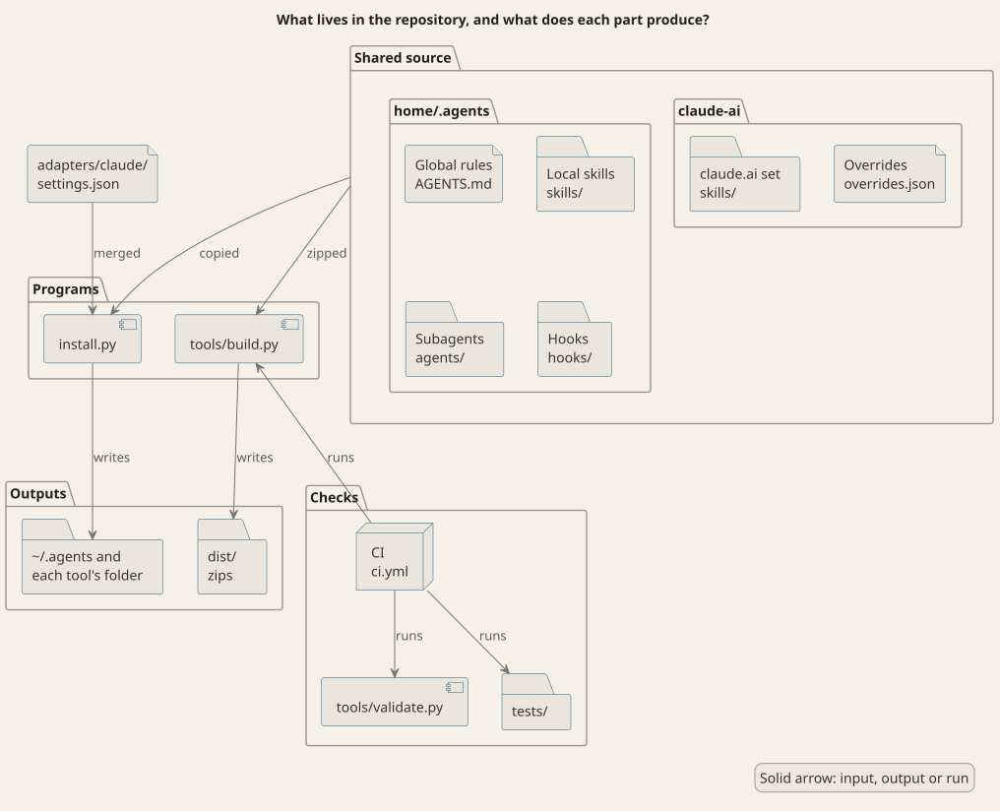
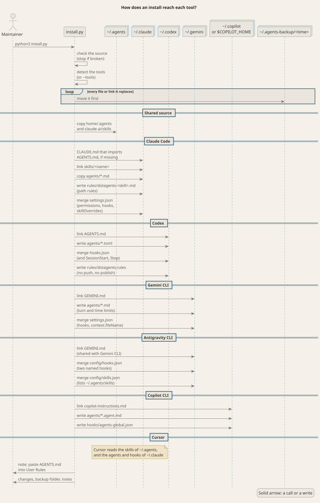
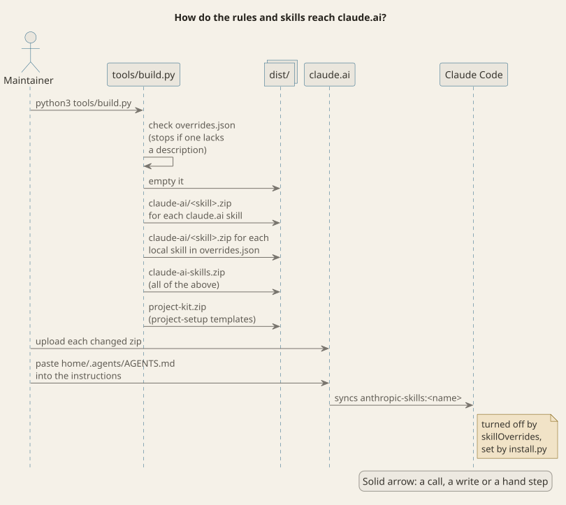
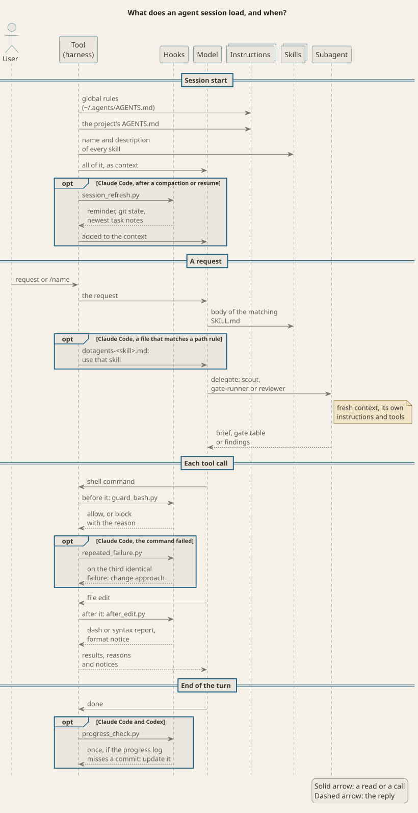
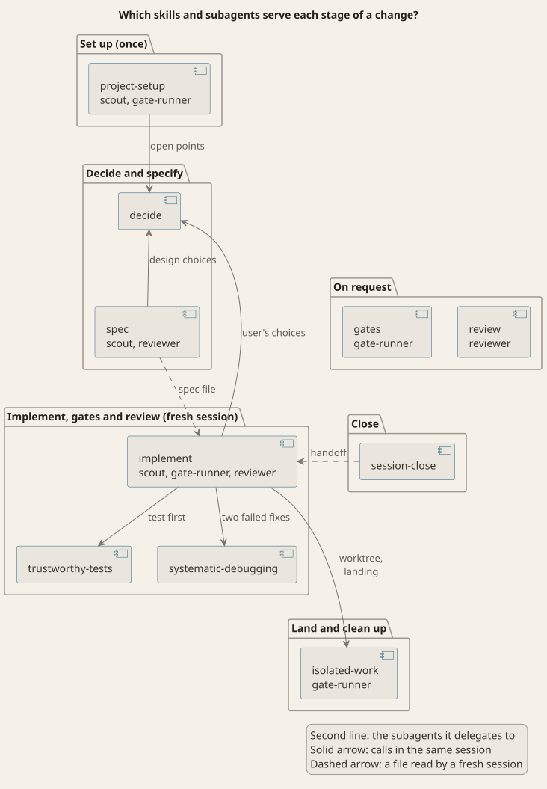
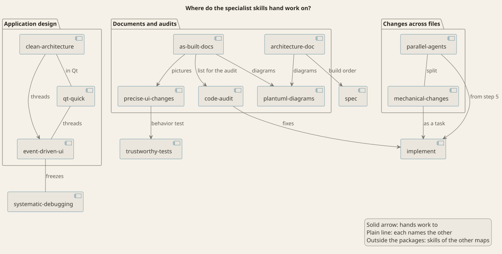
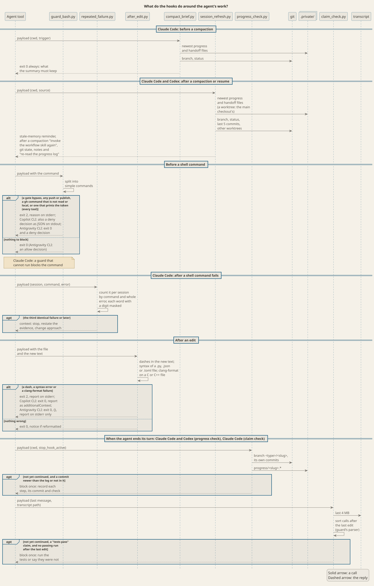

#+TITLE: dotagents architecture
#+SUBTITLE: how the parts relate and how they work together
#+OPTIONS: toc:2 num:nil ^:nil
#+STARTUP: showall

This file owns how the parts of the repository relate and how they work
together. [[file:../DESIGN.org][DESIGN.org]] owns the rules they keep;
[[file:pipeline.org][docs/pipeline.org]] owns the stages a change goes through;
[[file:glossary.org][docs/glossary.org]] owns the terms.

Each section answers one question with a diagram, then says how it works. The
diagram sources are in =docs/diagrams/=; each =.svg= is rendered from the
=.puml= next to it with the plantuml-diagrams skill.

* What lives where

What the repository holds, and what each part produces.

- =home/.agents/= is the installed source: the global rules (=AGENTS.md=), the
  18 local skills (=skills/=), the three subagents in Claude Code format
  (=agents/=) and the four hook scripts (=hooks/=). =install.py= copies all of
  it to =~/.agents=.
- =claude-ai/= holds the claude.ai set (=skills/=, ten skills), the overrides
  that upload local skills too (=overrides.json=, today only decide) and the
  upload guide (=README.md=). =install.py= reads the overrides to turn off
  Claude Code's synced copy of each uploaded skill; =tools/build.py= reads
  them for the local skills to zip and their short descriptions.
- =adapters/claude/settings.json= is the adapter for Claude Code: no
  attribution in commits and pull requests; permission rules that allow
  =git status=, =git diff=, =git log=, =git show=, =git merge-base=,
  =git rev-parse= and =git branch --show-current=, the CMake (=--preset=,
  =--build=, =-B=), CTest, clang-format and clang-tidy commands (also their
  =-20= names) and =./build/*=; ask before =git reset --hard=, =git clean=,
  =git rebase= and =rm -rf=; deny =git push= (also as =git -C <dir> push=) and
  reading =.env= files, =~/.ssh= and =~/.gnupg=; the synced plugin
  =engineering@synced= turned off; the four hook entries.
- =install.py= turns the three sources into =~/.agents= and each tool's files.
- =tools/build.py= turns the claude.ai set, the local skills named in the
  overrides and the project-setup templates (both from =home/.agents=) into
  zips in =dist/= (git-ignored).
- =tools/validate.py= checks the source; its docstring lists every check
  (skill and subagent frontmatter, name and description limits, a
  =LICENSE.txt= per skill, no inline backticks in skill prose, no em or en
  dash in any tracked or trackable file, no unfilled template marker, the
  global rules under 200 lines, every Python file compiling).
- =tests/= holds four unittest suites: the hooks fed each tool's payload
  shape, the installer run against a temporary =HOME=, validate and build run
  on a copy of the repository, and the scripts bundled with as-built-docs and
  precise-ui-changes.
- =.github/workflows/ci.yml= runs validate, the tests and build on every push
  and pull request, on Ubuntu with Python 3.9, Ubuntu with Python 3.12 and
  Pillow, and macOS with Python 3.12.
- =docs/= holds the guides, the glossary and the diagrams; it
  produces nothing. The rules that bind live in [[file:../DESIGN.org][DESIGN.org]].

* How an install reaches each tool

What =python3 install.py= does, in order, and what each tool receives.

1. Check the source. Every subagent file must parse and convert for Codex,
   Gemini CLI and Copilot CLI; the adapter must hold a hooks object and
   =overrides.json= a skills object. On any problem it prints the list,
   installs nothing and exits 1.
2. Choose the tools: the =--tools= list, or every tool whose folder
   (=~/.claude=, =~/.codex=, =~/.gemini=, =~/.gemini/antigravity-cli=,
   =~/.copilot= or =$COPILOT_HOME=, =~/.cursor=) or command (=agy= for
   Antigravity CLI) exists.
3. Shared source: copy every file of =home/.agents= to =~/.agents= (hook
   scripts made executable) and the claude.ai set into =~/.agents/skills=, so
   every tool sees both skill sets. A file left in an installed skill folder
   that the repository no longer has goes to the backup.
4. Claude Code: when =~/.claude/CLAUDE.md= lacks the import
   =@~/.agents/AGENTS.md=, replace it with one that has it (the old file goes
   to the backup); back up the =learn= and =handoff= skill copies and the hook
   copies in =~/.claude/hooks= that older versions left; link each skill
   folder in =~/.claude/skills= to =~/.agents/skills/<name>=; copy the
   subagent files unchanged to =~/.claude/agents=; merge the adapter into
   =~/.claude/settings.json=, adding =skillOverrides= that turn off the synced
   copy (=anthropic-skills:<name>=) of every skill also uploaded to claude.ai,
   and removing from =ask= every rule the adapter denies.
5. Codex: link =~/.codex/AGENTS.md=; write =agents/<name>.toml= (with
   =sandbox_mode= read-only for scout and =workspace-write= for the others,
   which Codex ignores in an agent file, and the reasoning effort when the
   source sets one); merge the guard, the after-edit hook and the
   session refresh (=SessionStart= after =compact= or =resume=) into
   =~/.codex/hooks.json=, which Codex asks the user to trust; write
   =rules/dotagents.rules=, whose =prefix_rule= entries forbid every push and
   publish (Codex rules are experimental).
6. Gemini CLI: link =~/.gemini/GEMINI.md=; write =agents/<name>.md= with Gemini
   tool names and a turn and time limit (=max_turns= 100 for each subagent;
   =timeout_mins= 120 for gate-runner, 60 for reviewer, 30 for scout), above
   Gemini CLI's defaults of 30 turns and 10 minutes; merge the two hooks into
   =~/.gemini/settings.json= and put =AGENTS.md= first in =context.fileName=,
   so project =AGENTS.md= files load.
7. Antigravity CLI: link =~/.gemini/GEMINI.md= (the same link as Gemini
   CLI's); merge the guard and the after-edit hook into
   =~/.gemini/config/hooks.json= under the names =dotagents-guard= and
   =dotagents-after-edit=, keeping an =enabled= value set by hand; add
   =~/.agents/skills=, as an absolute path, to the entries of the skills
   manifest =~/.gemini/config/skills.json=. No subagents and no session
   refresh.
8. Copilot CLI, in =$COPILOT_HOME= when it is set, else =~/.copilot=: link
   =copilot-instructions.md=; write =agents/<name>.agent.md= with Copilot tool
   names; write =hooks/agents-global.json=.
9. Cursor: write nothing. Cursor reads =~/.agents/skills=, =~/.claude/agents=
   and the Claude Code hooks by itself, so it gets subagents and hooks only
   when Claude Code is installed too; the installer reminds the user to paste
   the global rules into Cursor's User Rules.
10. Print the number of changes, the backup folder and the notes.

How it stays safe to run again:

- An identical file is left alone, so a second run changes nothing.
- A file or link that differs is moved first to
  =~/.agents-backup/<YYYYmmdd-HHMMSS>/=, under its path relative to =HOME=.
- A settings merge adds keys and list items, lets values already set win,
  removes earlier copies of this repository's hook entries (found by script
  path) and appends the current ones. A file that does not parse, or whose
  shape cannot take the entries, is left alone with a note to merge it by hand.
- =--dry-run= prints every action and changes nothing; =--audit= lists what in
  the agents' folders does not come from the repository, and broken links.
- A whole skill, subagent, hook script or settings entry the repository
  dropped stays in the tools' folders: =--audit= shows the first three, and
  settings entries are removed by hand.

Only the Claude Code copy of a subagent keeps its =model= field; the Codex,
Gemini CLI and Copilot CLI copies carry none, so they run on the tool's
default model.

* How the skills reach claude.ai

What =python3 tools/build.py= produces, and the hand steps that take it to
claude.ai.

1. Check that every override has a description; if one lacks it, stop before
   touching =dist/=.
2. Delete =dist/= and build it again.
3. One zip per skill of the claude.ai set: =dist/claude-ai/<name>.zip=.
4. One zip per local skill in =overrides.json=, with the long description in
   its =SKILL.md= replaced by the short one (claude.ai accepts at most 200
   characters).
5. =dist/claude-ai-skills.zip=: all those zips and =claude-ai/README.md=.
6. =dist/project-kit.zip=: the project-setup templates and the =LICENSE= file,
   to set up a repository by hand.

Every zip entry carries a fixed timestamp, so unchanged sources give identical
zips. The maintainer uploads each changed zip in claude.ai and pastes
=home/.agents/AGENTS.md= into its instructions. claude.ai then syncs its copies
into Claude Code as =anthropic-skills:<name>=; the =skillOverrides= that the
installer wrote keep them off, so Claude Code loads each skill once, from
=~/.claude/skills= ([[file:../DESIGN.org::#skills-load-locally][DESIGN.org, skills-load-locally]]).

* What a session loads

What an agent reads at the start of a session, and what it loads later on
demand.

1. Global rules. Each tool reaches =~/.agents/AGENTS.md= through its own file:
   the import in =~/.claude/CLAUDE.md=, the links =~/.codex/AGENTS.md=,
   =~/.gemini/GEMINI.md= (Gemini CLI and Antigravity CLI) and
   =~/.copilot/copilot-instructions.md=, and a paste
   in Cursor's User Rules and in claude.ai's instructions.
2. Project rules: the repository's own =AGENTS.md=. Claude Code reads it by
   itself only when the repository has no =CLAUDE.md=, so project-setup
   creates a =CLAUDE.md= (a bridge that imports =AGENTS.md=) only for notes
   that apply to Claude Code alone, and proposes replacing a =CLAUDE.md= that
   duplicates rules with that bridge, or deleting it.
3. Skill descriptions. Only each skill's name and description are listed at
   the start. The body of a =SKILL.md= loads when a request matches its
   description or the user names it; files next to it (templates, scripts,
   the palette) load only when a step reads them.
4. Compaction brief and session refresh. In Claude Code, before a compaction
   the tool runs the compaction brief, which tells the summary what resuming
   the task needs. In Claude Code and Codex, after a compaction or a resume the
   tool runs the session refresh, which adds a stale-memory reminder, the real
   git state and the newest task notes to the context.
5. Subagents. A skill step delegates to a subagent, which starts in a fresh
   context with its own file as instructions and its own tool list, and
   returns a compact result instead of the files or logs it read. Without
   subagents, the skill follows =~/.agents/agents/<name>.md= itself.
6. Hooks. The tool, not the model, runs the guard before each shell command
   and the after-edit hook after each edit, and passes their replies on to
   the model (the hooks section below).

| Subagent    | Model in Claude Code | Returns                                 |
|-------------+----------------------+-----------------------------------------|
| scout       | sonnet               | a cited brief of the area               |
| gate-runner | haiku                | a verdict table and the first errors    |
| reviewer    | opus, high effort    | findings ranked blocker, major, minor   |

scout and reviewer only read and run read-only commands; gate-runner runs the
documented gate commands and fixes nothing. In Claude Code gate-runner also
starts without the user, project and local =CLAUDE.md= files (=omitClaudeMd=,
Claude Code v2.1.271 or later); the other tools' copies drop the field.

* The workflow skills

Which skills and subagents serve each stage of a change; the stages
themselves, with what each leaves and where, are in [[file:pipeline.org][docs/pipeline.org]].

1. Set up: project-setup runs once per repository. scout surveys it, decide
   settles what the repository does not answer, and gate-runner runs each
   validation command once.
2. Decide and specify: spec maps the area with scout, settles each design
   choice with decide, and has a subagent that did not write it check the
   spec (in Claude Code the general-purpose subagent, elsewhere reviewer).
3. Implement, gates and review: a fresh session runs implement on the spec
   file. implement grounds the plan with scout, takes the user's choices to
   decide, writes each test first by trustworthy-tests, turns to
   systematic-debugging after two failed fixes, runs the full gates through
   gate-runner and the review through reviewer, and creates the worktree
   through isolated-work when the plan's isolation was approved.
4. On request: gates and branch-review are the user's direct way to the same two
   subagents; implement calls the subagents itself, not these skills.
5. Close: session-close writes the handoff that the next fresh session reads
   before resuming implement.
6. Land and clean up: on the user's go, isolated-work rebases the branch,
   gates the rebased commit through gate-runner, fast-forwards the target and
   removes the worktree and the branch.

decide is where every choice that belongs to the user is settled. Besides the
callers drawn here, architecture-doc, mechanical-changes, parallel-agents,
decision-analysis and scoping-before-building send their choices to it.

* The specialist skills

Where the specialist skills hand work on.

- Documents and audits. architecture-doc and as-built-docs draw their diagrams
  with plantuml-diagrams. architecture-doc ends with a build order whose every
  step is ready for spec. as-built-docs makes its screen pictures repeatable
  as precise-ui-changes does, and hands a list of suspicious behavior to
  code-audit. code-audit fixes nothing: a finding the user wants fixed goes to
  implement, starting with a failing test. In precise-ui-changes, a visual bug
  that plays out over time also needs a behavior test from trustworthy-tests.
- Changes across files. mechanical-changes runs as an implement task, with its
  shards as plan steps; to spread the shards over several agents it uses
  parallel-agents, which sends a one-rule change across many files back to
  mechanical-changes. Each parallel agent runs implement from section 5 with
  its approved plan steps, in a worktree that isolated-work creates and later
  lands. isolated-work runs its change through implement.
- Application design. clean-architecture gives the layers, event-driven-ui the
  threads, and qt-quick applies both in Qt. architecture-doc uses
  clean-architecture's layers for an application, and under spec or implement
  clean-architecture's steps for a feature become the plan's steps. A freeze
  whose cause is not yet measured goes to systematic-debugging first, which
  sends a blocked UI thread back to event-driven-ui.

The subagents these skills use:

- architecture-doc maps an existing codebase with scout and has both documents
  reviewed by a subagent that did not write them (the general-purpose
  subagent in Claude Code, reviewer elsewhere).
- as-built-docs reads the code with read-only subagents on the session's model
  (the general-purpose subagent in Claude Code, the tool's default general
  agent elsewhere), not with scout, and has each document fact-checked by one
  that did not write it (the general-purpose subagent in Claude Code, reviewer
  elsewhere); gate-runner runs its long pass or fail checks.
- code-audit maps with scout and tries to refute each finding with a subagent
  given only the claim and the code (the general-purpose subagent in Claude
  Code, elsewhere reviewer told that its target is the claim, not the branch
  diff).
- mechanical-changes sends its review to reviewer. parallel-agents gates each
  branch through isolated-work, which runs gate-runner on the rebased commit,
  and reviews the merged result through implement's review.

* The claude.ai skills

Where the skills of the claude.ai set hand work on.

[[file:diagrams/arch_skills_claude_ai.svg]]

The set is the ten skills of =claude-ai/skills/= plus decide, uploaded through
its override. The installer puts all of them in every local agent too, so the
same hand-offs work in chat and in a repository; a hand-off to a local skill
applies where that skill is installed (the texts say "where available").

- Debugging: systematic-debugging diagnoses first, reproduces the failure with
  a test by trustworthy-tests, applies the fix with minimal-editing, or with
  implement where it is available and the fix is more than a one-sentence
  change (implement then writes the failing test), and checks with
  verifying-before-claiming-done before saying it is fixed. It sends work
  that blocks a UI thread to event-driven-ui. trustworthy-tests sends a flaky
  or unclear failure back to systematic-debugging, and minimal-editing sends
  the fix of a failure there first.
- Choices: efficient-research gathers the facts, decision-analysis commits to
  a recommendation, and a choice inside the user's own project goes to decide,
  which turns to decision-analysis to compare outside products and proposes a
  spec when a decision is too large.
- Scoping: scoping-before-building sends the user's choices to decide, open
  work in a repository to spec, and a new system to architecture-doc.
- Prompts and handoffs: prompt-optimizer makes a single requested change with
  minimal-editing and sends a repository's =AGENTS.md= to project-setup;
  context-handoff gives way to session-close inside a repository.
- Closing: efficient-research, systematic-debugging and trustworthy-tests all
  end with verifying-before-claiming-done.
- tutor hands nothing on: it teaches by the Learning section of the global
  rules.

* The hooks

What each hook does around the agent's work.

Where each tool runs them:

- Claude Code: the guard on =PreToolUse= for =Bash=, the after-edit hook on
  =PostToolUse= for =Edit= and =Write=, the compaction brief on =PreCompact=
  (manual and automatic), and the session refresh on =SessionStart= after
  =compact= or =resume=.
- Codex: =PreToolUse= for =Bash=, =PostToolUse= for =apply_patch=, =Edit= and
  =Write=, and =SessionStart= after =compact= or =resume=, whose plain stdout
  Codex adds as developer context.
- Gemini CLI: =BeforeTool= for =run_shell_command=, =AfterTool= for
  =write_file= and =replace=.
- Antigravity CLI: =PreToolUse= for =run_command=, =PostToolUse= for
  =write_to_file=, =replace_file_content= and =multi_replace_file_content=,
  from =~/.gemini/config/hooks.json=.
- Copilot CLI: =preToolUse= for =bash=, =postToolUse= for =edit=, =create=,
  =str_replace_editor= and =apply_patch=.
- Cursor: the Claude Code hook commands, read from =~/.claude/settings.json=.

Every tool gives the guard 10 s and the after-edit hook 60 s; the session
refresh (Claude Code and Codex) and the compaction brief (Claude Code) get
10 s. Every hook
exits 0 on a payload it cannot read, so a broken payload never stops the work,
and prints nothing but JSON on Gemini CLI's and Antigravity CLI's stdout.

Compaction brief (=compact_brief.py=):

1. Ask the summary to keep what resuming needs: the task, its slug and the
   check that says it is done; the branch; the paths of the task's progress
   log and handoff; the workflow skill and the section or step of it that was
   running; the current plan step; each decision marked
   =Review: pending=; each constraint the user stated that no file records,
   word for word, and what is blocked on what; the files changed; the
   commands still needed and the last result of each command run.
2. Fill in what it can read: the branch, up to 15 lines of
   =git status --short= and the newest task notes, with session refresh's
   finder and time budget (8 s).
3. Print it, cut under Claude Code's 10,000-character cap, and exit 0 every
   time: exit 2 would block the compaction, and when the compaction recovers
   from a full context the request would fail. Its command ends in =|| true=
   because =python3= exits 2 when the script is missing.

Session refresh (=session_refresh.py=):

1. Print the reminder: the agent's memory of the code is a summary; re-read
   the files and confirm each symbol before editing. After a compaction, also
   ask the agent to invoke its workflow skill again: Claude Code keeps only the
   first 5,000 tokens of each skill invoked before it, and may drop older
   ones.
2. Add the branch (or the detached commit), up to 15 lines of
   =git status --short=, the last five commits and the repository's other
   worktrees with their branches (up to ten). A list that git could not
   give is named as missing, never shown as a clean tree.
3. Add the three newest files of =.private/progress/= and of
   =.private/handoff/=, with absolute paths, found in the working folder or a
   parent up to the repository root or, in a linked worktree, in the main
   checkout (the folder of =git rev-parse --git-common-dir=), and ask the
   agent to re-read the task's progress log. The
   notes are listed before git runs, so a slow git cannot leave them out; the
   listing and the git calls share 8 s, under the 10 s timeout past which
   Claude Code drops the output.
4. Exit 0; its stdout joins the agent's context.

Guard (=guard_bash.py=):

1. Find the command in the tool's payload and split it the way a shell does
   (quotes, operators, substitutions, here-documents, wrappers such as =sudo=,
   =env= and =timeout=). Text that does not parse is split roughly, ignoring
   quotes, so a parse error never lets a command through.
2. Block, in every tool, the gate bypasses: =--no-verify= on =git commit=,
   =push=, =merge=, =rebase=, =am=, =pull= and =cherry-pick=; =git commit -n=
   and =git am -n=; hook-skip variables (=*_SKIP_HOOKS=, =HUSKY= or
   =LEFTHOOK= set to off, =OVERCOMMIT_DISABLE=, a =SKIP= list with git or
   pre-commit); disabling =core.hooksPath=.
3. Block, in every tool, every push and publish: =git push=,
   =git subtree push=, =gh pr create= (or =gh pr new=), =gh pr merge=,
   =gh release create= and =gh repo sync=
   ([[file:../DESIGN.org::#no-agent-push][DESIGN.org, no-agent-push]]). A push that forces, deletes, mirrors or
   prunes, and =gh pr merge --admin=, are named as such. In Claude Code the
   adapter also denies =git push=, so the permission prompt never offers it;
   in Codex, =~/.codex/rules/dotagents.rules= forbids the same commands, also
   before the user trusts the hooks.
4. Blocking is exit 2 with the reasons on stderr, and advice: a push or a
   publish means the work is ready for the maintainer's review; a gate bypass
   means fix the failing check or ask the maintainer to run the command.
   Copilot CLI also gets a deny decision as JSON on stdout, the only text its
   model sees. Antigravity CLI, whose docs define a JSON decision and no exit
   codes, gets ={"decision": "deny", "reason": ...}= with exit 0 instead, and
   ={"decision": "allow"}= when nothing is blocked.

It guards the usual forms; it is not a security boundary: a command passed as
one string (=bash -c=, =eval=), aliases, scripts and =gh api= are not
inspected.

After-edit hook (=after_edit.py=):

1. Read the edited files and the new text from the payload of each tool: an
   edit's new string, a patch's added lines, a whole file's content. An
   Antigravity CLI call that reports an error wrote nothing and is skipped;
   its =multi_replace_file_content= is skipped too, because its docs give no
   fields for the chunks.
2. Report each line of the new text that holds an em or en dash (up to eight).
3. For a C or C++ file in a project with a =.clang-format=, when a clang-format
   binary is found, format in place only the lines the edit changed
   (=clang-format --lines=), within 50 s of the 60 s timeout. The lines come
   from the payload when it carries them (Claude Code's patch of the edit,
   also for a write over an existing file), otherwise from where the new text
   stands in the file; a file written in full without such a patch, a new
   file among them, is formatted whole, and an edit whose lines cannot be
   located is not formatted.
4. A dash or a clang-format failure is exit 2 with the report on stderr,
   which the agent sees; Copilot CLI shows that only to the user, so there the
   report goes to the model as =additionalContext= with exit 0. Antigravity CLI
   documents only ={}= as the reply, so there the hook prints ={}= with exit 0
   and the report goes to stderr, which its docs do not say reaches the agent.
   A reformat adds a notice to re-read the file before the next edit (on
   Antigravity CLI, on stderr too).
