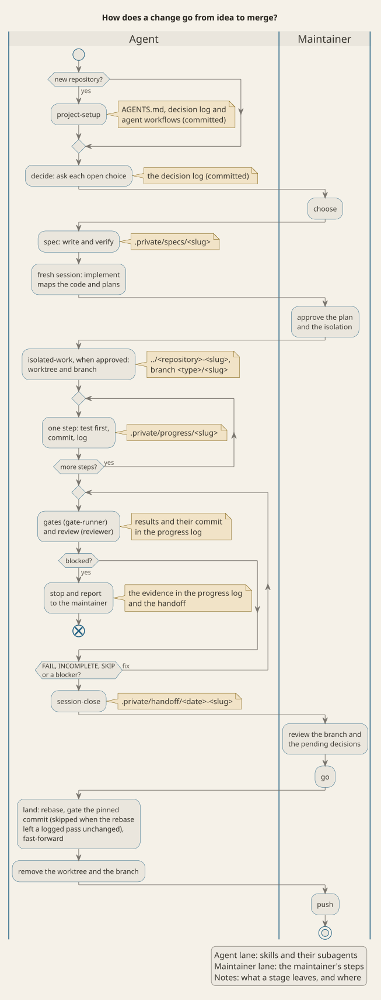

#+TITLE: From idea to merge
#+SUBTITLE: the stages a change goes through, and what each one leaves behind
#+OPTIONS: toc:2 num:nil ^:nil
#+STARTUP: showall

This file owns the method a change follows in a repository, from idea to
merge: the stages in order, the skill that runs each one, what it produces and
where that lives, where a fresh session starts, who lands and pushes, what
happens when a stage fails, how the maintainer reviews the agents' decisions,
and when work is isolated or split across agents. Each skill's =SKILL.md= owns
its own steps; [[file:../DESIGN.org][DESIGN.org]] owns the rules that bind;
[[file:workflow.org][docs/workflow.org]] says which skill to run in which situation;
[[file:glossary.org][docs/glossary.org]] owns the terms.

The skills call the maintainer the user. Paths use the task's slug and
=<ext>=, the project's prose format (=org= or =md=).

* Which stages a change needs

The global rules size the work first (Agentic work, in
[[file:../home/.agents/AGENTS.md][home/.agents/AGENTS.md]]):

- /A one-sentence change/ : done directly, with the narrow check, and reported.
  It still waits for the maintainer's review and push.
- /A multi-file or public API change/ : implement directly, without a spec: it
  maps the area with scout, shows the plan and waits for approval.
- /A large, ambiguous or cross-module feature/ : spec first, then implement in
  a fresh session. Every stage below applies.

* The stages

The diagram's notes name what each stage leaves and where; the sections below
add the skill, the subagents and where a fresh session starts.

** 1. Set up a new repository

- /Skill/ : [[file:../home/.agents/skills/project-setup/SKILL.md][project-setup]], once per repository, and again to audit it. scout
  surveys the repository, decide settles what it does not answer, gate-runner
  runs each validation command once.
- /Produces/ : =AGENTS.md= with the commands that worked, a decision log and an
  agent workflows doc in the repository's docs folder and prose format, the
  =.private/= lines in =.gitignore=, and, where needed, the bridges =GEMINI.md=
  and =CLAUDE.md= and project skills under =.agents/skills/=.
- /Lives in/ : the repository, committed when the maintainer asks.

** 2. Decide

- /Skill/ : [[file:../home/.agents/skills/decide/SKILL.md][decide]], for every choice that belongs to the maintainer (scope,
  public API, architecture, rules, trade-offs). project-setup, spec and
  implement call it; the maintainer can call it directly.
- /Produces/ : a decision the maintainer confirmed, with its reason, the
  rejected options and the condition that would reopen it.
- /Lives in/ : the project's decision log, committed. In dotagents that log is
  the Rules that bind section of [[file:../DESIGN.org][DESIGN.org]].

** 3. Specify

- /Skill/ : [[file:../home/.agents/skills/spec/SKILL.md][spec]]. It maps the area with scout, settles each design choice
  with decide, writes the spec, has a subagent that did not write it check
  every claim (in Claude Code the general-purpose subagent, elsewhere
  reviewer), and stops without writing code.
- /Produces/ : a self-contained spec that names files, symbols, commands and
  acceptance criteria a test or a command can fail. A rule change the
  maintainer approved sits among its deliverables with its exact text, so
  implement applies it without asking again.
- /Lives in/ : =.private/specs/<slug>.<ext>=, git-ignored, unless the project's
  spec workflow names another place.
- /Next/ : a fresh session (in Claude Code =/clear=) runs implement on the spec
  path.

** 4. Implement

- /Skill/ : [[file:../home/.agents/skills/implement/SKILL.md][implement]], in a fresh session. It grounds the plan with scout and
  its own reading of the code, and shows the plan: one commit per step, each
  with its files and its check. It waits for approval when the plan touches
  more than one file, changes a public API or meets the maintainer's choice.
  For a change across modules, a public API change, or a migration of data or
  many files, the plan proposes [[file:../home/.agents/skills/isolated-work/SKILL.md][isolated-work]], approved with the plan.
  Before the first step, and on resume, it runs the narrowest documented
  check on the base commit (on HEAD when resuming) and records the result as
  the baseline: a failure there predates the steps to come, so it is
  reported, never fixed silently.
- /Produces/ : the branch =<type>/<slug>=, one commit per step, each behavior
  change with a test seen failing first; the progress log, with the approved
  plan, the baseline, every step with its commit and check, every decision
  with who took it, every refuted assumption, and every attempt that failed
  (what was tried, the result, why it was dropped), so a fresh session does
  not retry it.
- /Lives in/ : the commits on a local branch. With isolation the branch lives
  in its own worktree, =../<repository>-<slug>=, created from the tip of the
  branch it will land on. The progress log is
  =.private/progress/<slug>.<ext>= in the main checkout, git-ignored and never
  committed; a worktree has no =.private/=, so the log is written there by
  absolute path.

** 5. Gates

- /Skill/ : implement delegates the project's full pre-PR gates to gate-runner,
  with the folder and the commit to test. The [[file:../home/.agents/skills/gates/SKILL.md][gates]] skill is the
  maintainer's direct way to the same subagent.
- /Produces/ : the HEAD the gates ran on and one row per gate: PASS, FAIL,
  INCOMPLETE or SKIP, with the first errors of each failure.
- /Lives in/ : the progress log, each run with its command, result and commit.

** 6. Review

- /Skill/ : implement delegates to reviewer with the intent, the progress log
  path and the base commit. The [[file:../home/.agents/skills/branch-review/SKILL.md][branch-review]] skill is the maintainer's direct way.
- /Produces/ : findings ranked blocker, major and minor, with what the reviewer
  could not verify and the gates not run. implement checks each finding at
  its location and gives it one disposition: fixed when the change caused
  it, contested only with evidence the reviewer could read, taken to the
  maintainer when the evidence lies outside the repository's files or
  several fixes are reasonable, deferred only when it predates the change. No
  severity changes and no finding is dropped silently. When the reviewer pass
  after the fixes still finds a blocker or major finding, the work stops for
  the maintainer: the cause is probably upstream (the spec, the plan or a
  rule). After a fix, the full gates run again on the final commit.
- /Lives in/ : implement's report and the progress log, each finding with
  its disposition.

** 7. Close the session

- /Skill/ : [[file:../home/.agents/skills/session-close/SKILL.md][session-close]], at the end of every working session and before
  clearing the context. It reads every progress log of the task (the
  per-agent logs of parallel work too) and brings this session's up to date
  from git and the commands that ran.
- /Produces/ : the handoff (goal, files touched, decisions, open questions,
  commands run, commands still needed, risks, refuted assumptions, and how
  to check it: for each acceptance criterion, the command or the steps and
  the visible result to expect, with each check that needs a human look
  marked), a draft rule change for each lesson, and the list of decisions
  waiting for the maintainer.
- /Lives in/ : =.private/handoff/<YYYY-MM-DD>-<slug>.<ext>=, git-ignored.
- /Next/ : the reply names the handoff and the single next action for a fresh
  session.

** 8. The maintainer's review

- /Who/ : the maintainer.
- /Reads/ : the branch (=git log= and =git diff= from its base commit), the
  gate results with the commit they ran on, the reviewer's findings, the
  progress log and the handoff, whose "How to check it" says how to try each
  acceptance criterion.
- /Decides/ : keeps or changes each agent decision (below), accepts or rejects
  each Proposed decision and each rule draft, and then gives the go to land,
  asks for changes, or drops the work.

** 9. Land

- /Skill/ : isolated-work (section 3), on the maintainer's go.
- /Steps/ : pin the branch's commit; rebase it onto the target's current tip
  inside the worktree, writing both hashes into the progress log; run the full
  gates on the pinned, rebased commit through gate-runner, because a rebased
  commit has never been tested; fast-forward the target to it; confirm the
  target now points there. A merge commit only when the project's documented
  convention asks for one.
- /Produces/ : a linear history on the local target branch.

Without isolation, the branch stays in the main checkout until the maintainer
lands it; no skill lands it, so the maintainer chooses how (the same rebase
and fast-forward keep the history linear).

** 10. Clean up

- /Skill/ : isolated-work, at the end of the landing.
- /Steps/ : remove the worktree (never forced without the maintainer), delete
  the branch only while it still points to the landed commit, prune stale
  worktree entries, and restart whatever still runs an older build.

* Where a fresh session starts

| After                                 | The next session                                    | Reads first                                  |
|---------------------------------------+-----------------------------------------------------+----------------------------------------------|
| spec                                  | runs implement on the spec path                     | the spec                                     |
| session-close                         | runs implement on the spec from the named plan step | the handoff, then the progress log           |
| a split approved by parallel-agents   | each agent starts at implement section 5            | its brief, with its approved plan steps      |
| a compaction or a resume, Claude Code | continues                                           | what the session refresh lists, then the log |
| a compaction, any other tool          | continues                                           | the progress log, when the maintainer asks   |

A resumed implement takes the slug from the branch or the log's file name,
reads the newest handoff of that slug for its open questions and the commands
still needed, checks the log against =git log= and the code, and keeps the plan
the log records as approved unless grounding changes it.

In a worktree, the session runs inside the worktree; the spec and the notes
stay in the main checkout's =.private/= and are passed by absolute path.

Claude Code and Codex run the session refresh after a compaction or a resume:
it prints the real git state, lists the newest files of =.private/progress/=
and =.private/handoff/=, and asks the agent to re-read the progress log and
invoke its workflow skill again. In the other tools, ask for that re-read.

* Who lands and pushes

- /Agents commit/ : on their own branch, one logical change per commit, when
  the maintainer asked or a skill they ran says so.
- /No agent pushes or publishes/ : in any tool ([[file:../DESIGN.org::#no-agent-push][DESIGN.org, no-agent-push]]). The
  guard blocks every =git push=, =git subtree push=, =gh pr create=,
  =gh pr merge=, =gh release create= and =gh repo sync=, and in Claude Code the
  settings also deny =git push=. The guard does not inspect =gh api=; there the
  rule rests on the agent.
- /Agents land on the maintainer's go/ : an isolated branch lands locally as
  isolated-work says, then its worktree and branch are removed
  ([[file:../DESIGN.org::#isolated-worktrees][DESIGN.org, isolated-worktrees]]).
- /The maintainer pushes/ : after the review, from the landed target. An agent
  that meets a push or a publish stops and tells the maintainer the work is
  ready for review.

* When a stage fails

| Failure                           | Response                                                                   | Recorded in                        |
|-----------------------------------+----------------------------------------------------------------------------+------------------------------------|
| The baseline check fails          | report it, since it predates the steps to come; never fix it silently      | progress log, as the baseline      |
| A gate FAILs                      | fix the code, never the gate or the test; gate the new commit              | progress log, with the commit      |
| A gate is INCOMPLETE or SKIP      | not passed, so not done; listed with its reason and its log                | handoff: commands still needed     |
| A review finding                  | fix, contest with evidence, ask, or defer if it predates the change        | progress log, with its disposition |
| A blocker or major after fixes    | stop and report: the cause is probably upstream (spec, plan or a rule)     | progress log and handoff           |
| Two failed fixes for one problem  | stop, restate the evidence, change approach with systematic-debugging      | progress log, as failed attempts   |
| The changed approach fails too    | stop and report with the evidence; the maintainer decides                  | progress log and handoff           |
| A refuted claim changes the plan  | stop and report before changing course; the maintainer decides             | progress log and handoff           |
| A conflict with a rule that binds | stop and state it; the maintainer changes the task or the rule             | progress log; a Proposed rule      |
| An interruption or a usage limit  | resume from the progress log, the newest handoff and the commits           | progress log                       |
| The guard blocks a command        | never route around it: report a publish as ready, or fix the gate's cause  | the reply to the maintainer        |
| Codex's sandbox blocks a commit   | ask for approval, or leave the step uncommitted and log it "not committed" | progress log                       |

The full gates run again on the final commit after any fix, and the reviewer
again on a fix that changed behavior or added or changed a test. A step marked
in progress without its commit is not discarded silently: the agent shows its
diff and the maintainer says whether to finish or discard it. A step logged
"not committed" because the sandbox blocked the commit is committed, with the
maintainer's approval, before the full gates; while one stays uncommitted, the
work is not landable. A parallel agent stopped by a usage limit resumes from
its commits once the coordinator tells it what is done and what comes next. A
guard block on a gate bypass means: fix the failing check, or ask the
maintainer to run the command themselves.

A refuted claim that does not change the plan is corrected and recorded in the
progress log and the handoff. For each one a rule should have prevented,
session-close drafts the smallest rule change, which waits for the
maintainer's approval of its exact text.

* Reviewing the agents' decisions

The agent takes routine engineering choices inside the approved plan; the
maintainer reviews them afterwards, in one place:

1. implement writes each one in the progress log when it is taken: the choice,
   its reason, the alternative not taken, marked by agent and
   =Review: pending=.
2. implement's report, session-close and the report of parallel-agents list
   every decision still pending, one line each.
3. The maintainer keeps or changes each one; the log then records kept, or
   changed with the entry that replaces it.
4. A decision that also meets the decision log's recording bar goes there as
   Proposed, and session-close asks the maintainer to accept it, reject it or
   leave it Proposed. Only the maintainer's confirmation makes it Accepted.

* Isolate, split or run a workflow

- /Default/ : one session and one writing agent, on a branch in the main
  checkout.
- /Isolate/ : with isolated-work, when implement's plan proposes it (a change
  across modules, a public API change, a migration of data or many files) or
  the maintainer asks. The main checkout and the target branch move only when
  the reviewed change lands.
- /Split/ : with [[file:../home/.agents/skills/parallel-agents/SKILL.md][parallel-agents]], only for parts that touch different files and
  do not need each other's results. Start with up to three writers and never
  run more than five: parallel writers cost several times the tokens of one
  and rarely finish much sooner, because landing is serial. The coordinator
  settles the maintainer's choices first, shows the split for approval, runs
  each writer through isolated-work, lands the branches one at a time, and
  reviews the merged result.
- /A workflow/ : the agent proposes one, with its rough cost, only for large
  work that splits into independent parts; otherwise one session runs the
  stages above.
